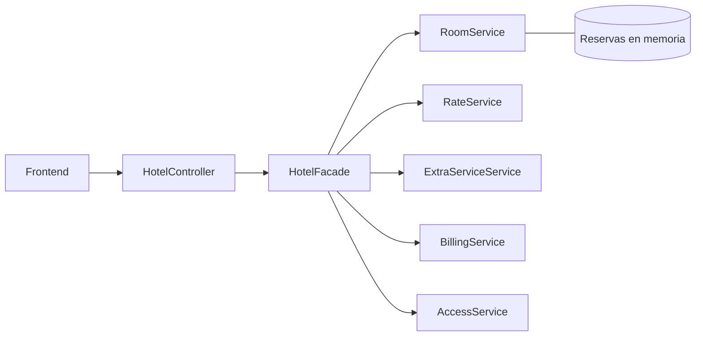

# Sistema de Reservas de Hotel — Backend (Patrón Facade)

API REST en **Spring Boot (Java 21)** que implementa el **patrón de diseño Facade**
para el caso de estudio *Sistema de Reservas de Hotel*.

> Todos los montos están en **pesos colombianos (COP)**. El caso de estudio fija
> los costos de los servicios adicionales (spa, desayuno/día, traslado) sin indicar
> moneda, por lo que se interpretan en COP.

---

## 1. Caso de estudio

Un hotel necesita un sistema digital de reservas. La operación interna involucra:

- Gestión de habitaciones (disponibilidad, reserva y liberación).
- Cálculo de **tarifas dinámicas** según temporada (alta = base × 1.5, baja = base),
  número de noches y tipo de habitación (sencilla, doble, suite).
- **Servicios adicionales** con costo extra: spa, desayuno (por día) y traslado.
- **Facturación** detallada con desglose.
- **Control de acceso**: código de llave digital (UUID) por habitación reservada.

El hotel tiene **16 habitaciones** predefinidas (7 sencillas, 5 dobles, 4 suites).

---

## 2. El patrón Facade en este sistema

`HotelFacade` es el **único punto de entrada** al subsistema del hotel. El cliente
(el controlador REST y, por ende, el frontend) nunca habla directamente con los
subsistemas: llama a una operación legible y la fachada coordina todo por detrás.

### Subsistemas (encapsulados, no se conocen entre sí)

| Subsistema | Rol |
|---|---|
| `RoomService` (`HabitacionService`) | Inventario de habitaciones y almacén de reservas en memoria; disponibilidad, reservar y liberar. |
| `RateService` (`TarifaService`) | Calcula noches y aplica el multiplicador de temporada (alta ×1.5, baja ×1). |
| `ExtraServiceService` (`ServicioAdicionalService`) | Catálogo de servicios extra y su costo (spa, desayuno/día, traslado). |
| `BillingService` (`FacturacionService`) | Genera la factura detallada; en el checkout añade el cargo de servicio por noche. |
| `AccessService` (`AccesoService`) | Emite la llave digital (UUID) para la habitación reservada. |

### Operaciones de la fachada

```java
createReservation(ReservationRequest)   // crearReserva
addExtraService(reservationId, type)     // agregarServicio
checkIn(reservationId)                   // realizarCheckIn
checkOut(reservationId)                  // realizarCheckOut -> factura final
findAvailability(type, checkIn, checkOut)
getReservation(reservationId)
```

### Diagrama



La complejidad interna (cálculo de temporada, costos por noche, generación de
factura, emisión de llaves) queda oculta tras la fachada. Agregar un subsistema
nuevo no cambia la interfaz que consume el frontend.

---

## 3. Autenticación

- Registro e inicio de sesión propios.
- Contraseñas **encriptadas con BCrypt** (nunca se almacenan en texto plano).
- Validadores de entrada (formato de correo, nombre, **contraseña fuerte** y
  confirmación) tanto en backend como en el cliente.
- Token tipo JWT (HMAC-SHA256) para proteger los endpoints de gestión.
- `GET /api/hotel/disponibilidad` y `GET /api/hotel/servicios` son públicos;
  reservar y gestionar requiere `Authorization: Bearer <token>`.

---

## 4. Endpoints REST

| Método | Ruta | Descripción | Auth |
|---|---|---|---|
| POST | `/api/auth/register` | Registro de usuario | No |
| POST | `/api/auth/login` | Inicio de sesión | No |
| GET | `/api/auth/me` | Perfil del usuario autenticado | Sí |
| GET | `/api/hotel/disponibilidad` | Disponibilidad por fechas y tipo (+ precio dinámico) | No |
| GET | `/api/hotel/servicios` | Catálogo de servicios adicionales | No |
| POST | `/api/hotel/reservar` | Crear reserva | Sí |
| POST | `/api/hotel/servicios/{reservaId}` | Agregar servicio a una reserva | Sí |
| PUT | `/api/hotel/checkin/{reservaId}` | Realizar check-in (emite llave) | Sí |
| PUT | `/api/hotel/checkout/{reservaId}` | Realizar check-out (factura final) | Sí |
| GET | `/api/hotel/reserva/{reservaId}` | Consultar una reserva | Sí |
| GET | `/api/hotel/reservas` | Listar reservas | Sí |

### Ejemplo

```bash
# Registro
curl -X POST /api/auth/register -H 'Content-Type: application/json' \
  -d '{"fullName":"Ana Torres","email":"ana@hotel.com","password":"Segura123","confirmPassword":"Segura123"}'

# Disponibilidad (pública)
curl "/api/hotel/disponibilidad?type=SUITE&checkIn=2027-07-01&checkOut=2027-07-04"
```

---

## 5. Tecnologías

- Java 21, Spring Boot 4.1.1, Maven (wrapper incluido).
- `spring-security-crypto` (BCrypt) + token JWT propio sin dependencias extra.
- Estado en memoria con colecciones Java (sin base de datos).
- JUnit 5 + AssertJ para las pruebas.

---

## 6. Cómo ejecutar

```bash
./mvnw spring-boot:run          # http://localhost:8080
./mvnw test                     # pruebas
./mvnw -DskipTests package      # jar en target/
```

Variables de entorno:

| Variable | Descripción | Default |
|---|---|---|
| `PORT` | Puerto HTTP | `8080` |
| `APP_JWT_SECRET` | Clave de firma del token | valor de desarrollo |

---

## 7. Despliegue

El backend se empaqueta como contenedor Docker (`Dockerfile` multi-stage) y se
despliega en **AWS Lightsail Container Service**, con un endpoint HTTPS público.
Ver el README del frontend para la URL de producción y la configuración DNS.
